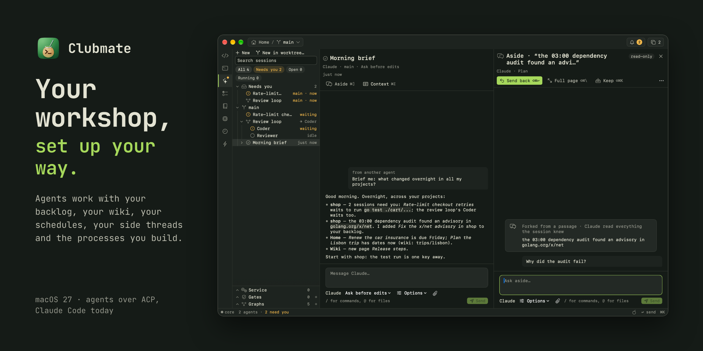
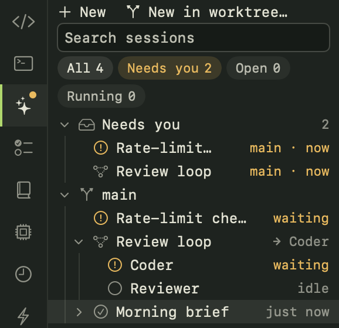
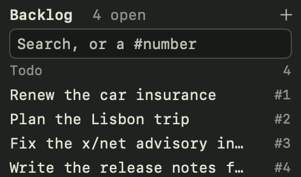
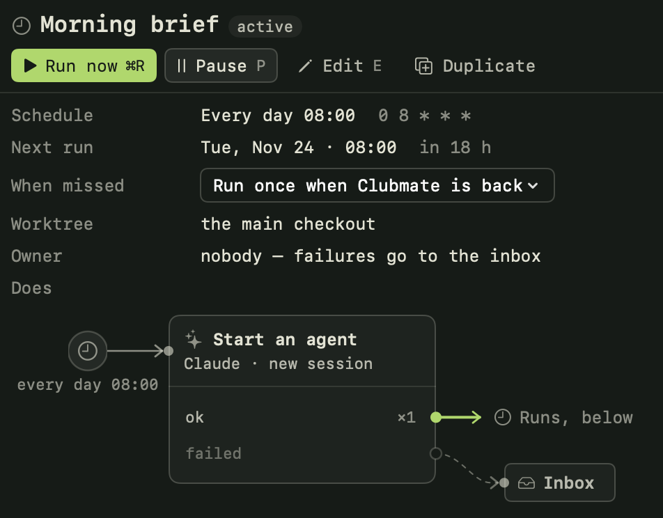
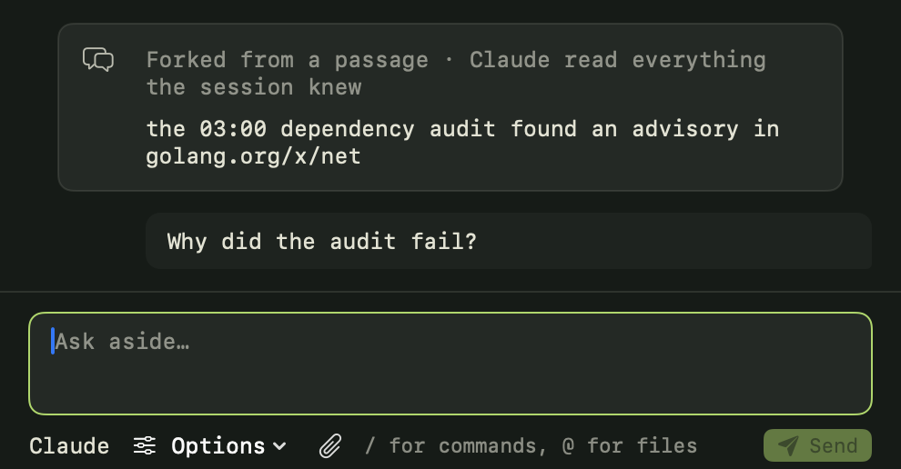
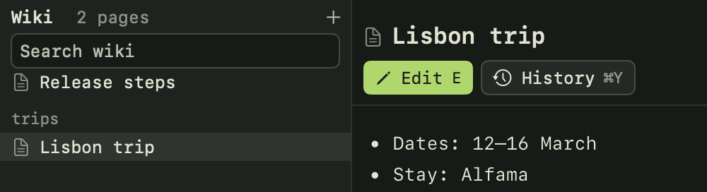
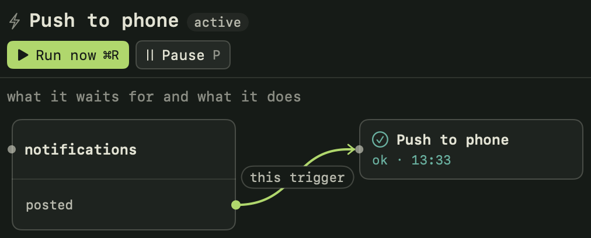

  

# Clubmate

**Your workshop on the Mac, set up your way.** Agents work there with your backlog, your wiki, your schedules,
your side threads and your processes, on every project and in Home.

**[Download for macOS](https://github.com/ggfarmco/clubmate/releases/latest)**
· macOS 27 or later · signed and notarized · updates itself

## What's in the workshop

<table>
<tr>
<td width="270"><b>Agents</b> Coding agents over ACP, Claude Code today. Each can work in its own worktree, a git checkpoint every turn, and Needs you when one waits. <a href="docs/agents.md">More</a></td>
<td></td>
</tr>
<tr>
<td width="270"><b>Backlog</b> Your tasks, per project and in Home, shared with the agents. <a href="docs/backlog.md">More</a></td>
<td></td>
</tr>
<tr>
<td width="270"><b>Cron and Triggers</b> Agents that start on a schedule, or when something happens. This one briefs you every morning at 08:00.</td>
<td></td>
</tr>
<tr>
<td width="270"><b>Side threads</b> Ask something on the side: an aside is a read-only fork of a session, open beside it.</td>
<td></td>
</tr>
<tr>
<td width="270"><b>Wiki</b> Your own wiki. Agents write to it as they learn your code and your plans. <a href="docs/wiki.md">More</a></td>
<td></td>
</tr>
<tr>
<td width="270"><b>Your own processes</b> Agent graphs like coder → reviewer loops, land gates before anything lands, and triggers that wire them together.</td>
<td></td>
</tr>
<tr>
<td width="270"><b>Your phone</b> Watch, answer and prompt from your iPhone or iPad, over Tailscale or through the Clubmate relay. <a href="docs/remote.md">More</a></td>
<td></td>
</tr>
</table>

## Get started

1. Download the `.dmg` from [Releases](https://github.com/ggfarmco/clubmate/releases/latest)
   and drag Clubmate to Applications.
2. Open a project folder (⌘O), or start in Home (⇧⌘H).
3. Press ⌘N to start an agent.

## Requirements

- macOS 27 or later
- Claude Code: agents run on it today, so you need a Claude Code
  login and Node 22 or later
- git, for worktrees, checkpoints and the wiki
- Companion: iPhone or iPad on iOS 27, with Tailscale or the relay

Neovim is built in and on; turn on VS Code, or turn both off,
in Settings › General › Editors.

## More

[Agents](docs/agents.md) · [Wiki](docs/wiki.md) · [Backlog](docs/backlog.md) · [Remote](docs/remote.md) · [Security](SECURITY.md) · [License](LICENSE)
