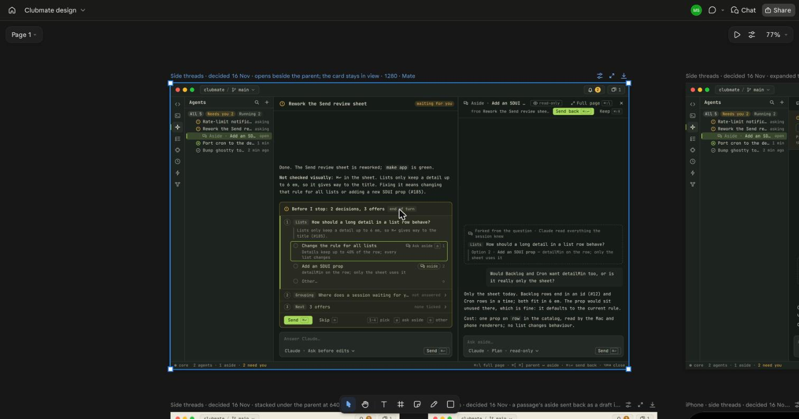
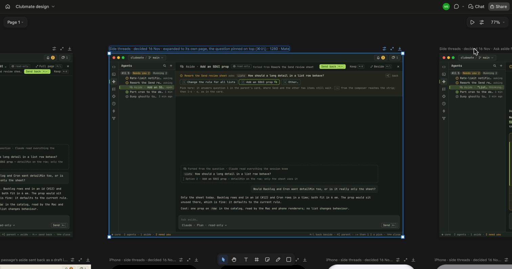
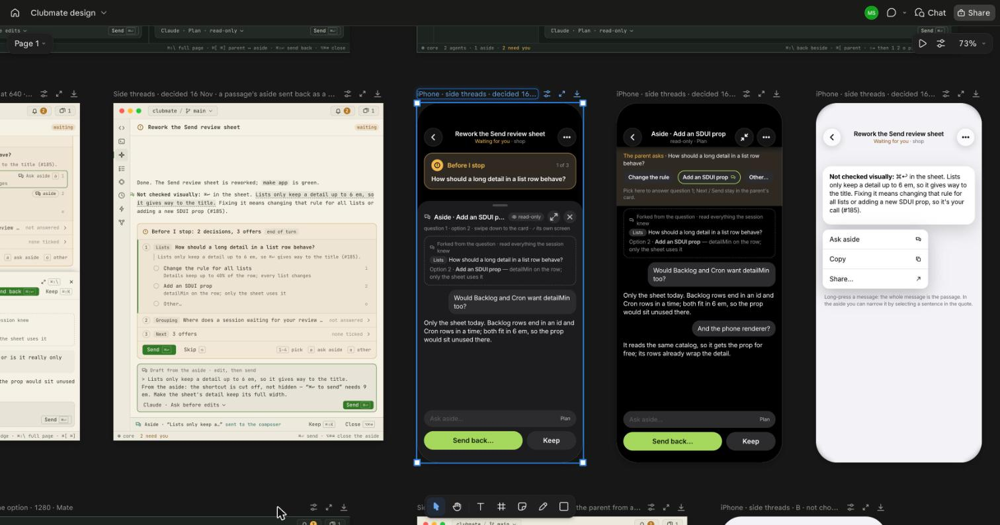

# Side threads — final design (decided 16 Nov)

Final boards, PNGs and rules: `design/features/side-threads/` (from the Claude Design project, section **Side threads (#601)**). Final = A (opens beside) + C (the aside is its own session page).

## Beside the parent (default)

The aside opens in a split beside its parent; the question card stays in view. Header: read-only · ⤢ Full page ⌘⇧\ · Send back ⌘⇧↩ · Keep ⌘⇧K · × (⌥⌘⌫). `a` on a focused option asks aside; an option with an aside shows an "aside" mark.

## Expanded to its own page (⌘⇧\)

An ordinary session page with the parent's question pinned as a strip on top; a chip in the strip answers that question in the parent's card (Send and the other questions stay there). ⌘⇧\ or ⤡ Beside goes back; ⌘[ goes to the parent.

## 640 and phone

640: the aside stacks under the parent (left: a passage sent back as a draft into the composer). Phone: a sheet over the session (⤢ pushes the session screen with the strip), and long-press a message → Ask aside.

First-round directions (A, B, C) are in `boards/round1/`.
